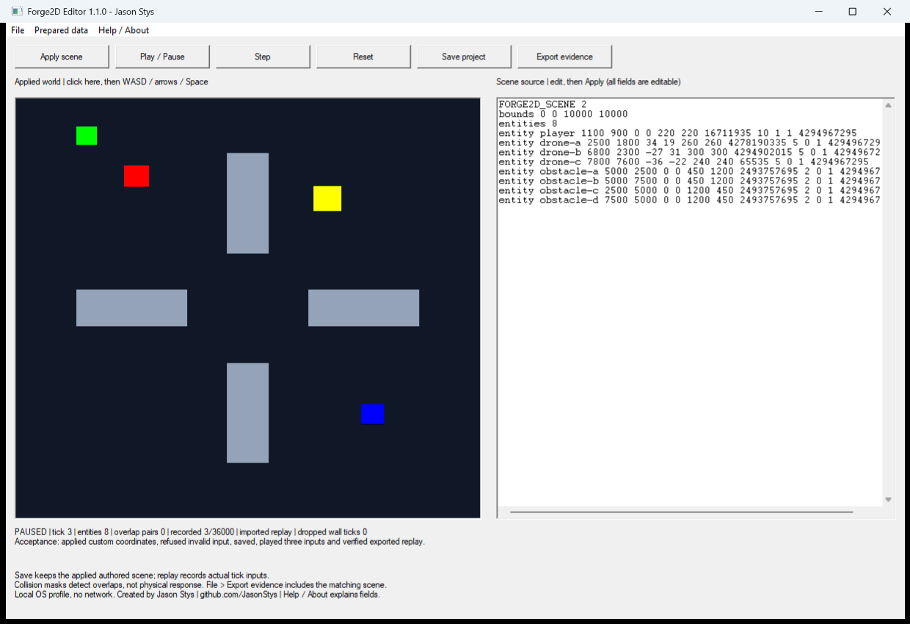
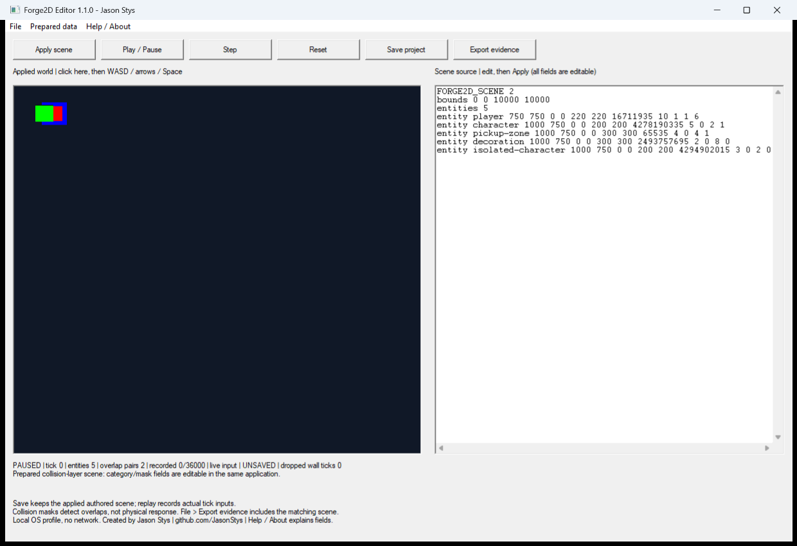

# Native Forge2D Editor

The Windows portable app contains the actual statically linked C++ engine, software renderer and
strict scene/replay parsers. Extract the entire package, then launch `Forge2DEditor.exe`. Keep its
`assets` directory beside it. There is no Python/Node/JDK installation or network dependency.
The first-use status and Help / About explain the controls. The title, help and footer credit Jason
Stys and link his source/contact profile. This unsigned portable candidate is not an OS installer;
system trust prompts, shortcut installation and manual accessibility acceptance are separate work.

## Complete workflow

1. Choose **Prepared data > Prepared arena** or **Collision layers**, or File > Open scene.
2. Edit the right-hand scene text, then **Apply scene**. Every existing field is editable, including
   bounds, positions, velocity, extents, color, rendering layer, player and category/mask. Invalid
   input leaves the previous applied world and saved project intact. The buffer remains editable.
3. Click the canvas. WASD/arrows control the player; Space records the action bit. **Step** performs
   one actual engine tick; **Play / Pause** advances fixed 60 Hz ticks with bounded catch-up. The
   native clock drops excess wall ticks instead of accumulating an unlimited backlog. **Reset**
   returns to the applied authored scene and clears the new recording.
4. **Save project** stores the applied authored scene in `%LOCALAPPDATA%/Forge2DEditor/project.scene`.
   Apply pending edits before saving. Running positions/faults are not silently baked into that file.
   Restart restores the authored scene paused at tick zero, not a running simulation.
5. File > Import replay loads recorded inputs against the currently applied scene. Play/Step then
   consumes those inputs and stops at the final frame. The native editor requires 60 Hz and at most
   36,000 frames. A replay is not an authenticated scene reference: use the corresponding scene.
6. **Export evidence** chooses a new `.evidence` directory beside your selected base name. It writes
   `scene.scene`, `inputs.replay`, `frame.ppm`, `snapshot.csv` and `summary.json`. CSV contains only
   numeric entity IDs/fields, avoiding scene-name spreadsheet formula interpretation. The summary
   records actual tick, state/pixel hash and overlap counts; the full scene accompanies the replay.





## Limits and recovery

The native input budget is 1 MiB, 1,000 entities, and 36,000 input frames (ten minutes at 60 Hz).
The existing library/CLI parser limits remain independent. Empty scenes are supported. Scene v1
imports use the existing explicit v2 filter migration. World bounds must fully contain every body.
Player inputs override that body's authored velocity; other bodies follow the existing boundary
clamp/bounce model. Rendering layers do not alter collision categories. This editor does not add
physical collision response, triggers, sprite assets, a scripting/plugin system or a commercial
engine asset pipeline. Pathfinding remains the separate tested library API, not an editor navmesh.

Only one process owns a profile at a time. Project reads use actual bounded regular-file handles;
hardlinks/reparse-point inputs and invalid UTF-8 are refused. Saves use a fresh random exclusive
staging file, flush, then atomic replacement. Data is plaintext under the OS account; another process
with the same user's permissions or an administrator is trusted. No multiuser login is claimed.

A malformed saved project is preserved. The editor starts a prepared working copy, shows a recovery
notice and requires explicit confirmation before replacing that saved file. Export recovery before
choosing replacement. Closing warns about unapplied/unsaved work. Existing export folders are never
overwritten; a failed export can leave a partial **new** folder, which must be inspected manually.
Back up the profile after clean exit; do not delete the owner file to bypass a running process.

## Build and actual package acceptance

In a scoped Visual Studio x64 developer shell with CMake/Ninja:

```powershell
powershell -NoProfile -File scripts/build-native.ps1 -Output release/my-candidate
python scripts/smoke-native.py release/my-candidate/Forge2DEditor-1.1.0-windows-x64.zip artifacts/native/my-run
```

The first command builds the static-runtime native app and all real CTests, verifies embedded
Windows author/version metadata, records Git source/dirty state, and writes a fresh ZIP/sidecar.
The acceptance helper extracts that actual archive into a fresh temporary directory, strips
developer runtimes from its child's PATH, runs three real visible-window launches with only marked
synthetic data, and verifies the executable's compiled source/version against package metadata.
The first exercises editing/play/export, the second checks durable restart, and the third preserves
an intentionally corrupt saved scene while visibly offering a prepared recovery working copy.
Actual native controls and timer events are exercised without external mouse/keyboard automation.

The read-only native CI job performs the same workflow. Routine PR/push runs retain only bounded
synthetic receipts and screenshots for one day. A full unsigned package is retained only through an
explicit trusted-main manual opt-in. The Windows CodeQL build extracts the Win32 host as well as the
portable core; Linux compilation/analysis, SDL, sanitizer/fuzz, benchmark, coverage and container
gates remain. No successful hosted result or public release is implied by a local candidate.
